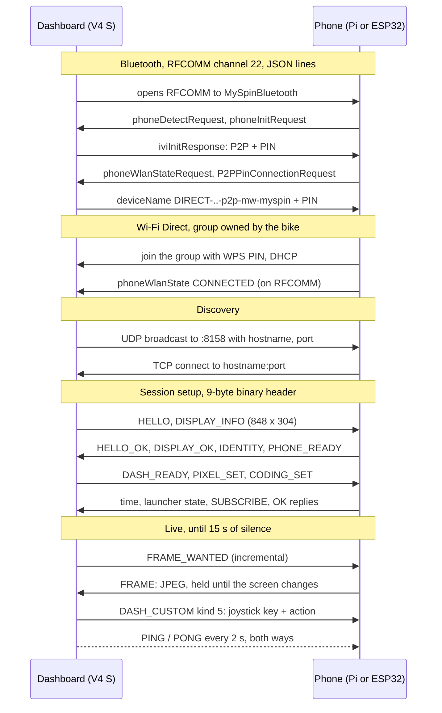
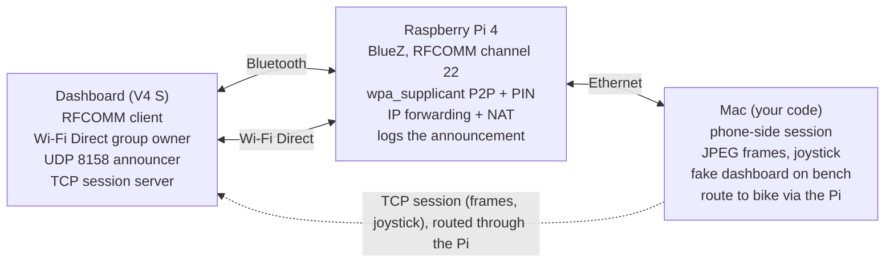
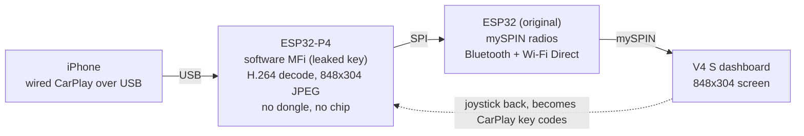

# Bosch mySPIN on the Multistrada V4: wire protocols and API

Nov 18, 2026 · Paul Traina. Reverse-engineered from the `myspin/` binaries in this repository; see [README.md](README.md) for how.

## Scope and sources

The Multistrada V4 S dashboard speaks the phone side of Bosch mySPIN over three links: a Bluetooth RFCOMM control channel carrying JSON lines, Wi-Fi Direct, and a binary TCP session that carries JPEG frames out and joystick events back. Everything below was recovered from the `myspin/` package in this repository and checked by running it.

**What `myspin/` is.** Nine Cython 3.3.1 extension modules built for CPython 3.13 aarch64 (`fields`, `catalog`, `revisions`, `control`, `discovery`, `phone`, `feed`, `pixels`, `tally`), about 1.2 MB in total. Their string constants are LZSS-compressed, so `strings` shows little.

**How it was examined.**

1. Loaded the modules in a `python:3.13-slim` linux/arm64 container on the Mac and dumped every class, signature and module constant. This gave the full opcode table, every message layout and the three protocol revisions.
2. Recovered the decompressed string table by scanning each module's writable segments for pointers to live `str`/`int`/`tuple` objects (JSON keys, message names, error texts, log events).
3. Called the encoders (`fields.seal`, `Revision.build`) to get exact bytes for each message.
4. Ran `PhoneControl` and `PhoneProjection` against a scripted fake dashboard in the container and captured every byte they sent.
5. Read the open Python in `mtspi/` (`session.py`, `bridge.py`, `bluez.py`) and the README for what was seen on the real bike.

**Confidence.** The phone-side encoding (byte layouts, opcodes, JSON shapes) is observed: it comes straight from the code. The dashboard-side messages are inferred. They are what the phone code accepts, and they agree with the bike logs and comments in `mtspi/`, but no capture from a real dashboard was available here. Each section notes which is which.

**Licence.** `myspin/LICENSE.txt` allows personal, non-commercial use and study, and says the files exist for interoperability. An ESP32 that you write from this description for your own bike stays within that spirit. Do not ship the `.so` files or sell a product built on them.

## System overview

The dashboard is the server and the phone is the guest: the bike opens Bluetooth to the phone, owns the Wi-Fi group, announces its address and serves the TCP session. The phone renders 848×304 pictures on request and receives the joystick.



*mySPIN connection on the V4 S: 5 phases, 17 messages.*

The phone speaks first only on Bluetooth (detect, init); on TCP the dashboard leads every step. On the bike the Pi went from key-on to Ducati Connect ready in about 53 s, most of it the Pi's own boot (28 s) and Wi-Fi (16 s).

## Bluetooth control channel

The phone publishes an RFCOMM service and the dashboard connects to it as the client. Over it, the two sides exchange newline-terminated JSON until the phone knows how to join the bike's Wi-Fi. The channel then stays open, and the bike reopens it at every key-on and after a radio dropout.

**Service the phone must publish (observed in `mtspi/bluez.py`).**

| Item | Value |
| --- | --- |
| SDP service name | `MySpinBluetooth` |
| Service class UUID | `31fd954e-8138-4367-a201-0276b9716fb1` |
| RFCOMM channel | 22 (BlueZ needs it set explicitly, or the record has no channel and the bike cannot open it) |
| Role | phone = RFCOMM server, bike = client and connection initiator |
| Security | no authentication required on the service; the link itself is bonded beforehand from the dashboard's pairing menu (SSP numeric comparison, phone agent `DisplayYesNo`) |

**Line format (observed).** One JSON object per line, UTF-8, compact separators, ended by `\n`:

```json
{"id":"<uuid4>","type":"phoneInitRequest","payload":{...}}
```

`id` is a fresh UUID4 per message. A few messages carry `"version":"3"` instead of a payload. The phone checks that the dashboard's control revision is 3.

**Exchange.** The phone's lines are observed byte for byte. The dashboard's replies are inferred: they are the shapes the phone code accepts.

1. Phone → `{"type":"phoneDetectRequest","version":"3"}`
2. Bike → `{"type":"iviDetectResponse","version":"3","payload":{}}`
3. Phone → `{"type":"phoneInitRequest","payload":{"regionCode":"IT","version":3,"phoneOS":"Android"}}`
4. Bike → `{"type":"iviInitResponse","payload":{"version":3,"customerID":"…","connectionType":"P2P"|"AP","authenticationType":"PIN"|"PBC"}}`
5. Phone → `phoneWlanStateNotification` with `{"phoneWlanState":"READY"}`, then `phoneWlanStateRequest` with `{}`
6. Bike → `{"type":"iviWlanStateResponse","payload":{"iviWlanState":"READY"}}`
7. Phone asks for credentials, choosing the request by the bike's answer in step 4:
   - P2P + PIN → `phoneWlanP2PPinConnectionRequest` with `{}`; bike answers `iviWlanP2PPinConnectionResponse` with `{"deviceName":"DIRECT-..-p2p-mw-myspin","pin":"12345670"}`
   - P2P + PBC → `phoneWlanP2PPbcConnectionRequest` with `{"deviceName":"<phone BT name>"}`; bike answers `iviWlanP2PPbcConnectionResponse` with `{"deviceName":"…"}`
   - AP → `phoneWlanAPConnectionRequest` with `{}`; bike answers `iviWlanAPConnectionResponse` with `{"ssid":"…","password":"…","frequencyBand":"…"}`
8. The phone joins Wi-Fi (next section), then sends `phoneWlanStateNotification` with `{"phoneWlanState":"CONNECTED"}`.

Other types the phone understands: `iviWlanStateNotification`, `iviWlanStateRequest` (the phone answers `phoneWlanStateResponse`), `iviErrorNotification` / `iviError` (treated as a wireless failure), `iviUnknownTypeNotification` (the bike refused a message type). The phone answers an unknown type with `phoneUnknownTypeNotification` carrying `unknownType`.

**What the V4 S chooses.** The bike, not the phone, picks the link. On the V4 S it is **P2P with a PIN**: comments in `mtspi/session.py` (bike tests on 16 Nov 2026) describe a persistent group named `DIRECT-..-p2p-mw-myspin`, owned by the bike, joined with the PIN it sends. The AP branch exists in the code but was not seen on this bike.

**A lead for the ESP32.** `mtspi/session.py` mentions a "pro variant" where this RFCOMM service runs on an ESP32 under BTstack (`esp32/btstack_phone`, `mtspi/esp32_bike.py`). Neither file is in this repository, but it shows the author got the Bluetooth half working on an ESP32.

## Wi-Fi Direct, discovery and the TCP connection

The phone joins the bike's Wi-Fi Direct group as a client, waits for a UDP broadcast on port 8158 that names the dashboard's address and port, and opens a TCP connection to it. The bike is the server at every step after Bluetooth.

**Joining the group (observed in `mtspi/session.py`, tried on the bike).** The V4 S is always the group owner of a persistent group whose device name looks like `DIRECT-..-p2p-mw-myspin`. The Pi:

1. scans for P2P peers (`p2p_find`) until one has `device_name` equal to the `deviceName` from the control channel;
2. waits up to 12 s for that peer to show it owns a group (bit 0 of `group_capab`), because right after the dashboard says Wi-Fi is ready the group can be missing for a few seconds;
3. joins with WPS PIN, entering the bike's PIN (`p2p_connect <addr> <pin> keypad join`);
4. takes an IPv4 address from the bike's DHCP server and installs no default route (the bike's network has no internet).

On the AP branch the phone simply joins `ssid` with `password` as an ordinary WPA2 client.

**Discovery (observed).** The phone binds UDP `0.0.0.0:8158` with `SO_BROADCAST`, `SO_REUSEADDR` and `SO_REUSEPORT` and waits (60 s by default) for one datagram holding a JSON object:

```json
{"hostname":"192.168.49.1","port":5000,"version":2,"identification":"…"}
```

| Key | Rule enforced by the phone |
| --- | --- |
| `hostname` | dashboard IPv4 address; if empty, `hostname_v6` is used; neither → rejected |
| `port` | integer, or a string of digits; 1–65535 |
| `version` | integer (a string such as `"1.2"` is rejected) |
| `identification` | required, any value |

The values above are placeholders: the real address, port and identification the V4 S announces were not recorded in this repository. Log the first datagram on your ESP32 and you will have them.

**TCP.** The phone connects to `hostname:port` with a 10 s timeout and sets `TCP_NODELAY`. If the session ends, it goes back to listening on UDP 8158 and starts again; the bike re-announces.

## mySPIN session protocol (TCP)

Every packet is a 9-byte little-endian header followed by a body, and the dashboard always speaks first. All layouts below are observed: they were dumped from `myspin.catalog` and checked by encoding and decoding live packets.

**Header.**

| Offset | Size | Field |
| --- | --- | --- |
| 0 | u8 | opcode |
| 1 | u32 LE | reserved; the phone always sends 0 and ignores it on receive (meaning unknown) |
| 5 | u32 LE | body length; the phone rejects bodies over 8 MiB |

**Field types.** All integers are little-endian. `text` = u8 charset (1 = UTF-8, 2 = Latin-1) + u16 byte length + bytes. `blob32` / `blob16` = u32 or u16 length + bytes. `list<u8,T>` = u8 count + items. Example: HELLO 1.2.0 is `01 00000000 06000000 0100 0200 0000`.

**Opcodes.** D = dashboard, P = phone. A field marked (2.0) is present only in protocol 2.0; (1.x) only before 2.0.

| Op | Name | Dir | Body |
| --- | --- | --- | --- |
| 1 | HELLO | D→P | major u16, minor u16, patch u16 |
| 2 | HELLO\_OK | P→D | ok u8 = 1 |
| 11 | DISPLAY\_INFO | D→P | title text, width u16, height u16, phys\_width u16, phys\_height u16, opaque u32, pixel\_format u8, byte\_order u8, preferred\_coding u32, level u8, coding\_mask u32, list\<u8,u16>, list\<u8,u8> (1.2, 2.0), u16 (2.0), u32 (2.0) |
| 12 | DISPLAY\_OK | P→D | ok u8 = 1 |
| 14 | IDENTITY | P→D | product text (1.x), flag u8, u8, u8 (1.x), features u32, system text, remark text (1.2, 2.0) |
| 17 | DASH\_READY | D→P | ok u8; anything but 1 means the dashboard refused |
| 18 | PHONE\_READY | P→D | ok u8 = 1 (1.2, 2.0 only) |
| 21 | PIXEL\_SET | D→P | pixel\_format u8, byte\_order u8, level u8 |
| 22 | PIXEL\_OK | P→D | ok u8 = 1 |
| 23 | CODING\_SET | D→P | coding u32 |
| 24 | CODING\_OK | P→D | ok u8 = 1 |
| 25 | FRAME\_WANTED | D→P | screen u32 (2.0), x u16, y u16, width u16, height u16, incremental u8 |
| 26 | FRAME | P→D | screen u32 (2.0), marker u8 = 1, x, y, width, height u16, pixel\_format u8, byte\_order u8, coding u32, level u8, u8 = 100, u8 = 100, picture blob32 |
| 31 | SOFT\_BUTTON | D→P | button u8, action u8, timestamp u32 (2.0) |
| 35 | DASH\_STATE | D→P | kind u8, value u8, screen u32 (2.0) |
| 36 | PHONE\_STATE | P→D | kind u8, value u8, pad u32 (2.0) |
| 54 | SUBSCRIBE | P→D | codes: list\<u8,u32> (1.2) or list\<u16,u32> (2.0) |
| 55 | VEHICLE\_VALUE | D→P | code u32, text, u32 (2.0) |
| 61 | VOICE\_CAPS | D→P | u8, u8 |
| 67 | DASH\_CUSTOM | D→P | kind u8, code u16, size u16, data\[size\] |
| 68 | PHONE\_CUSTOM | P→D | kind u8, code u16, data blob16 |
| 69 | LOCALE | D→P | 3 ASCII bytes, e.g. `ita` |
| 128 | PING | both | seq u32 |
| 129 | PONG | both | seq u32 (echo) |
| 162 | PEER\_QUERY | D→P | u8, u32, u32 (2.0; ignored during setup) |
| 169 | INIT\_EXTENSION | D→P | u16, u16 (2.0) |

**Setup sequence (protocol 1.2, captured from the phone code against a scripted dashboard).**

1. D: HELLO 1.2.0 → P: HELLO\_OK
2. D: DISPLAY\_INFO → P: DISPLAY\_OK, then IDENTITY, then PHONE\_READY
3. D: DASH\_READY = 1 → the phone goes live and sends, without being asked:
   - PHONE\_CUSTOM kind 2 code 4, data = u64 UTC seconds
   - PHONE\_CUSTOM kind 2 code 6, data = u64 local-time seconds
   - PHONE\_STATE kind 4 value 1 ("launcher shown")
   - PHONE\_CUSTOM kind 1 code 1, data = text such as `[HFP,A2DP]MTS Pi` (connected audio profiles + Bluetooth name; only when configured)
   - SUBSCRIBE with the vehicle-data codes it wants (the Pi asks for 1…128)
4. D: PIXEL\_SET → P: PIXEL\_OK
5. D: CODING\_SET → P: CODING\_OK
6. D: FRAME\_WANTED (incremental = 0) → P: FRAME. From here on, see Screen frames.

The IDENTITY the phone sends for 1.2, as bytes: `0e 00000000 2c000000 01 1500 "mySPIN Android Server" 01 01 01 06000000 01 0700 "Android" 01 0000`. The phone presents itself as mySPIN's Android server; features = 2 (1.1), 6 (1.2) or 14 (2.0).

**Revision differences.** 1.1 has no DASH\_READY/PHONE\_READY exchange (the phone goes live right after DISPLAY\_INFO) and no SUBSCRIBE. 2.0 adds the screen id and timestamp fields, INIT\_EXTENSION and PEER\_QUERY, and drops the product name from IDENTITY. Which revision the V4 S announces is not recorded here: an ESP32 should accept all three and branch on the HELLO it receives.

**Keep-alive (observed).** The phone sends PING every 2 s with a counter; the dashboard answers PONG with the same number. The phone also answers the dashboard's PINGs. If nothing arrives from the dashboard for 15 s, the phone drops the session.

**Other events.** PHONE\_STATE kind 1 value 1/0 tells the dashboard a call started or ended (the Pi sends it from its call handling). VEHICLE\_VALUE delivers subscribed vehicle data as text; what each code means on the V4 S is not documented here.

## Screen frames

The dashboard pulls frames: it sends FRAME\_WANTED for a rectangle, and the phone answers with exactly one FRAME for that rectangle, picture in the coding the dashboard chose. On the V4 S the area given to the phone is 848×304 (README, bike).

**Request/answer rules (observed).**

- The first request has `incremental = 0` and is answered at once.
- Each later request has `incremental = 1`. The phone **holds** it until the screen content changes, then answers immediately. In the test, a held request was answered 5 ms after a joystick event changed the picture, and not at all during 1.5 s with no change.
- The dashboard sends its next FRAME\_WANTED after receiving a FRAME, so one request is outstanding at a time. Frame rate is set by how fast the phone produces pictures: the Pi measured 7–13 fps on the bike with CarPlay.
- The phone answers the requested area (`x`, `y`, `width`, `height`), and the FRAME repeats it. Only screen 0 exists; a request for any other screen is an error.
- The phone checks sizes: each side at most 4096, area at most 2 097 152 pixels.

**FRAME example (protocol 1.2), 848×304 JPEG.**

```
1a 00000000 <len u32>            header, opcode 26
01                               marker
0000 0000 5003 3001              x=0 y=0 w=848 h=304
04 01                            pixel_format, byte_order (copied from PIXEL_SET)
01000000                         coding = 1 (JPEG)
00                               level (copied from PIXEL_SET)
64 64                            two constant bytes, 100 and 100 (meaning unknown)
<u32 size> ffd8ffe0 ...          picture
```

**Codings** (CODING\_SET; DISPLAY\_INFO's `coding_mask` says which the dashboard accepts):

| Code | Coding | Picture bytes |
| --- | --- | --- |
| 1 | JPEG | a baseline JPEG/JFIF of the rectangle; pixel format and byte order do not apply. A black 848×304 picture with one line of white text came out at about 5.2 kB |
| 2 | zlib | zlib stream (level 1) of the raw pixels below |
| 4 | raw | width × height pixels, row by row, no padding |

**Pixel formats** (PIXEL\_SET; used by zlib and raw only). Byte order 1 = "big", 2 = "little". Bytes for one pure red pixel:

| pixel\_format | byte\_order 1 | byte\_order 2 |
| --- | --- | --- |
| 2 = RGB565 | `f8 00` | `00 f8` |
| 3 = ARGB32 | A R G B: `ff ff 00 00` | B G R A: `00 00 ff ff` |
| 4 = RGBA32 | R G B A: `ff 00 00 ff` | A B G R: `ff 00 00 ff` |

Which codings and pixel format the V4 S offers is not recorded in this repository. The Pi's picture-quality setting changes JPEG quality and the frame rate on the bike with it, which suggests the V4 S selects JPEG (inferred). A raw 848×304 RGB565 frame is 515 kB, which is why JPEG matters for an ESP32 (see the ESP32 plan).

## Joystick input

The handlebar joystick reaches the phone as DASH\_CUSTOM (opcode 67) with kind 5. The action travels in the `code` field and the data holds the key code and a dashboard timestamp. Decoded by sending each combination to the phone code and reading what it reported.

**Layout.**

```
43 00000000 0a000000     header: opcode 67, body length 10
05                       kind = 5 (rider key)
04 00                    code = action (u16)
05 00                    size = 5
1f                       key code (u8)
88 13 00 00              dashboard time in ms (u32)
```

That example is DOWN, CLICK, at 5000 ms. The phone also accepts the data without the timestamp (1 byte).

| Key code | Key |  | Action code | Action |
| --- | --- | --- | --- | --- |
| 30 | UP |  | 1 | PRESS |
| 31 | DOWN |  | 2 | RELEASE |
| 32 | LEFT |  | 3 | LONG\_PRESS |
| 33 | RIGHT |  | 4 | CLICK |
| 12 | OK (centre) |  | 6 | ABORT |
| 14 | BACK |  |  |  |
| 20 | ROTATE\_CW |  |  |  |
| 21 | ROTATE\_CCW |  |  |  |

**What the real V4 S sends (README, bike, 16 Nov 2026).** Left, right and centre arrive only as CLICK. Up and down arrive as PRESS, then LONG\_PRESS after about 0.9 s if held, then RELEASE. Holding left belongs to the bike (it leaves Ducati Connect). A held centre press never arrives, and there is no BACK key on this bike. ROTATE\_CW/CCW are in the table but the V4 S joystick has no wheel. So a demo should treat UP/DOWN PRESS and LEFT/RIGHT/OK CLICK as the events to act on.

**SOFT\_BUTTON (opcode 31).** A separate message: button u8, action u8 (same action codes), and a u32 timestamp in 2.0. The phone reports it as `SOFTKEY_<n>`. It was not seen from the joystick on this bike.

**Hidden state.** DASH\_STATE kind 3 value 1 means the phone's screen is not visible (the rider left Ducati Connect); value 0 means it is back. The phone drops joystick events while hidden.

**Other DASH\_CUSTOM kinds.** Any kind other than 5 is logged and ignored by the phone.

## The myspin Python API

`myspin.phone` exports three names, and `mtspi/session.py` shows the whole flow in under 300 lines. Use it as the reference when porting.

| Call | What it does |
| --- | --- |
| `PhoneControl(reader, writer, log, region="IT", device_name="MTS Pi")` | wraps an open RFCOMM stream |
| `await control.negotiate(timeout=30)` | runs the JSON exchange; returns `{"p2p": True, "device_name", "pin", "band": "p2p"}` or `{"ssid", "password", "band"}` |
| `await control.notify_wlan("CONNECTED")` | sends `phoneWlanStateNotification` once Wi-Fi is up |
| `await discover_vehicle(log, port=8158, timeout=60)` | waits for the UDP announcement; returns `{"host", "port", "version", "identification", "source"}` |
| `PhoneProjection(reader, writer, frames, log, jpeg_quality=80, bt_info=None, vehicle_keys=None)` | one TCP session; `bt_info` is the `[HFP,A2DP]Name` text, `vehicle_keys` the codes to SUBSCRIBE |
| `await session.run()` | runs until the link drops or 15 s of silence |
| `session.screen_changed()` | wake the frame feed now instead of waiting for its 40 ms poll |
| `await session.server_state(kind, value)` | sends PHONE\_STATE, e.g. `(1, 1)` call started, `(1, 0)` ended |
| `session.min_interval`, `session.jpeg_quality` | frame-rate cap (seconds between frames) and JPEG quality, settable live |

**The `frames` object you supply.** It needs four members:

- `version`: a **property** (not a method) returning any comparable value that changes whenever the picture changes. The feed polls it every 40 ms and answers a held incremental request when it differs.
- `render(width, height)`: returns a PIL image of that size.
- `on_key(key, action)`: receives names such as `("UP", "PRESS")` or `("OK", "CLICK")`.
- `on_frame_sent(size)`: called after each FRAME with its byte size.

For the ESP32 these map onto three small pieces of C: a frame provider (version counter + a JPEG for the current state), a key callback, and the packet loop.

## Test platform: Raspberry Pi 4

Use a Raspberry Pi 4 as the first test platform. It has the same Wi-Fi/Bluetooth chip as the Pi 3 A+ that MTS Pi runs on, and BlueZ and `wpa_supplicant` handle every layer of this protocol. The repository already contains a working Hello World + joystick test screen, so you can start from something that works on the bike and replace the closed `myspin` package with your own code one layer at a time.

**Why it fits.**

| Need | On the Pi 4 |
| --- | --- |
| Bluetooth Classic with a custom SDP record | BlueZ `ProfileManager1.RegisterProfile` publishes `MySpinBluetooth`, UUID `31fd954e-…`, channel 22 (`mtspi/bluez.py`, `RfcommServer`) |
| Wi-Fi Direct client with WPS PIN | `wpa_supplicant` P2P: `p2p_find`, `p2p_connect <addr> <pin> keypad join` (`join_p2p()` in `mtspi/session.py`) |
| Radio | Cypress CYW43455, 2.4 + 5 GHz, Bluetooth 5.0: the same chip and `brcmfmac` driver as the Pi 3 A+, so the bike results should carry over |
| Demo app | `mtspi/session.py` + `mtspi/testui.py`: pairs, negotiates, joins, draws a test menu at 848×304, moves it with the joystick |

**Differences from the tested setup.** MTS Pi was tried on the bike only with a Pi 3 A+, so treat these as untested:

- `install.sh` checks the board model and prints a warning on a Pi 4, then carries on.
- The ready-made card image was built and tried on the Pi 3 A+. Install by hand on a fresh Raspberry Pi OS Lite 64-bit (Debian 13 "trixie") instead.
- Power: the Pi 4 wants a 5 V 3 A USB-C supply, and the tank-compartment socket gives 1 A at most. Use a USB power bank for tests on the bike.

**Setup.**

1. Flash Raspberry Pi OS Lite 64-bit, set the Wi-Fi country, and enable SSH.
2. Clone the repository and run `./install.sh --no-carlinkit` as the normal user. No Carlinkit is needed for the test screen.
3. Pair the bike with the Pi as in the README's Pairing step 1 (dashboard: Settings › Bluetooth › Pairing › Phone, pick the Pi, Accept). If your own phone was paired with the bike, disconnect it there so the bike talks to the Pi.
4. Check the bike's Wi-Fi band once connected: `wpa_cli -p /run/wpa_p2p status` on the `p2p-wlan0-*` interface shows `freq=`. The Pi 4 handles both bands, but the ESP32 is 2.4 GHz only, so a 5 GHz group would rule out the ESP32 port.

**Running the test screen instead of the bridge.** With the bike on, let `mtspi-wifi-mode` put the Pi in bike mode, then:

```bash
sudo systemctl stop mtspi-bridge          # it owns the same RFCOMM service
set -a; . /etc/default/mtspi; set +a      # WPA_CTRL=/run/wpa_p2p, WPA_P2P_DEV=p2p-dev-wlan0
.venv/bin/python mtspi/session.py --log /var/lib/mtspi/test.jsonl \
    --ap-credentials-file /var/lib/mtspi/ap-test.jsonl
```

Open Ducati Connect on the dashboard: the test menu should appear and follow the joystick. `sudo systemctl start mtspi-bridge` puts MTS Pi back.

**What the first run tells you.** The JSON log answers most of the open questions:

| Log event | Answers |
| --- | --- |
| `ctl_vehicle_init` | link and authentication type the bike chooses |
| `ctl_direct_offered` | the group name, and whether a PIN is used |
| `tcp_connected` | the real dashboard address and port |
| `hello_received` | protocol revision |
| `display_described` | screen size, pixel format, byte order, `coding_mask`, preferred coding |
| `joystick` | each key and action exactly as the V4 S sends them |

The group passphrase is not logged, and `mtspi-p2p.conf` has `update_config=0`. To test the ESP32 fallback, the passphrase has to be captured and compared across key-ons. Compare sha256 fingerprints rather than printing it.

**From test screen to your own implementation.** Keep `session.py` as the harness and replace one `myspin` call at a time with your own module written from this document, in this order: `discover_vehicle` (UDP JSON), `PhoneControl` (RFCOMM JSON), then `PhoneProjection` (the binary session). After each swap the test screen should still appear. If it does not, the old version is one line away for comparison. What you end up with is a reference implementation of every layer to port to the ESP32, plus logs from the real bike.

## Development setup: Mac + Pi 4

A Mac cannot reach the bike on its own, but next to the Pi 4 it can run your own session code against the real dashboard. The Pi does the radio work (Bluetooth control channel, Wi-Fi Direct join) and routes the Mac's TCP traffic to the bike over an Ethernet cable. This setup is a proposal: none of it has been tried.

**Why not the Mac alone.**

- **Wi-Fi Direct:** macOS has no Wi-Fi Direct or WPS API for developers, so the Mac cannot join the bike's group with the PIN. This is the blocker.
- **Bluetooth:** IOBluetooth can publish a custom service record and accept RFCOMM, but the API is old, channel 22 may not be honoured, and a Mac pairs as a computer, which the dashboard's phone pairing menu may not list.
- **The `myspin` binaries** are Linux-only, and Docker on a Mac cannot use the Mac's radios.
- UDP, TCP and drawing JPEGs are easy on a Mac.



*Mac + Pi 4 development setup (proposed, not tried): 3 devices, 4 links.*

The dashboard sees only the Pi: Bluetooth and Wi-Fi Direct end there, and the Mac's TCP session reaches the bike through the Pi's NAT.

**Stage 1: the bench, Mac only.** Write your phone-side code (discovery, session, frames, joystick) in Python on the Mac and test it against a fake dashboard written from this document. The scripted dashboard used for this analysis does that and could be turned into a repository tool. Nothing here needs the bike or the Pi.

**Stage 2: on the bike, Pi as radio front end.**

1. **Cable.** Connect the Mac to the Pi 4's Ethernet port (most Macs need a USB-C Ethernet adapter). Give both fixed addresses, for example Pi `10.42.0.1/24` (`nmcli con add type ethernet ifname eth0 ipv4.method manual ipv4.addresses 10.42.0.1/24`) and Mac `10.42.0.2/24` (System Settings › Network › the adapter › Manual).
2. **Radio-only mode on the Pi.** The Pi must pair, run the control channel and join Wi-Fi Direct, but leave the TCP session to the Mac. `session.py` cannot stop at that point yet: it needs a small change (for example a `--radio-only` flag) that stops after `notify_wlan("CONNECTED")`, logs the UDP announcement, and keeps the control channel open.
3. **Routing on the Pi**, once the group is up (Debian 13 may need `sudo apt install iptables`, which uses nftables underneath):

```bash
sudo sysctl -w net.ipv4.ip_forward=1
P2P=$(ls /sys/class/net | grep '^p2p-wlan0-')
sudo iptables -t nat -A POSTROUTING -o "$P2P" -j MASQUERADE
ip -4 addr show "$P2P"            # shows the bike's subnet
```

4. **Route on the Mac**, then check that the dashboard port answers (address and port from the Pi's logged announcement):

```bash
sudo route -n add -net <bike subnet> 10.42.0.1
nc -vz <dashboard address> <dashboard port>
```

5. **Run your session code on the Mac** with that address and port. Skip UDP discovery: the announcement does not cross the Pi, and the address it names is the one you just routed to. The dashboard sees the Pi's address, as if the Pi were the phone.

**Stage 3 (optional): the control channel on the Mac too.** A short script on the Pi accepts the bike's RFCOMM connection and relays the bytes to the Mac over TCP, where your own control-channel code answers. The Pi still has to join Wi-Fi, so the relay must also watch for the credentials response and run the join itself. `session.py` already reads the control channel from TCP on the bench (`--control tcp:PORT`), so the Mac side has a precedent.

**What could go wrong.** The bike might keep the session tied to the device that ran the control channel. The Pi does both here, so that case is covered. The 15 s silence limit still applies: keep PING/PONG running on the Mac while you debug, or the dashboard drops the session at a breakpoint. When every layer runs in your own code on the Mac, the same code is the reference for the ESP32 port.

## ESP32 plan: Hello World and the joystick

An ESP32 "phone" that shows Hello World and reacts to the joystick looks feasible. It needs the original ESP32 (Bluetooth Classic), JPEGs prepared in advance, and one risky step: joining the bike's Wi-Fi Direct group without a Wi-Fi Direct stack. This section is a plan, not code.

**Board.** Use an **original ESP32** (for example ESP32-WROVER, with PSRAM). The control channel is RFCOMM over Bluetooth Classic. The S2, S3, C3 and C6 have only Bluetooth LE, so they cannot do it. ESP-IDF runs Wi-Fi and Classic Bluetooth together with its coexistence scheduler; expect lower throughput, which is fine for a few small JPEGs.

**Components to build.**

| Piece | Approach | Notes |
| --- | --- | --- |
| Bluetooth pairing | bond once from the dashboard's pairing menu, then reconnect | Accept SSP numeric comparison automatically. Setting the Class of Device to Phone/Smartphone is a safe guess; whether the dashboard filters on it is not known |
| RFCOMM service | BTstack (the author's own ESP32 route) or Bluedroid with a custom SDP record | Must publish UUID `31fd954e-…`, name `MySpinBluetooth`, channel 22. Bluedroid's plain SPP server publishes the standard SPP UUID, so a raw SDP record is needed there: check your IDF version supports it |
| Control JSON | cJSON (bundled with ESP-IDF), line buffer, UUID4 ids | About eight message types; mirror the exact lines in the Bluetooth section |
| Wi-Fi join | legacy WPS-PIN client to the bike's `DIRECT-…` group (see risk below) | DHCP from the bike; keep the default route off |
| Discovery | UDP socket on 8158, `SO_BROADCAST`, parse one JSON datagram | Log the first one: it gives the real address and port |
| Session | TCP client, 9-byte header parser, state machine, PING every 2 s | Copy the Pi's optional messages too (time, PHONE\_STATE launcher, SUBSCRIBE): nobody knows yet which ones the dashboard requires |
| Pictures | 848×304 baseline JPEGs stored in flash | One per demo state, about 5–10 kB each, so a few dozen kB in total |

**The Wi-Fi Direct risk.** ESP-IDF has no Wi-Fi Direct client. A Wi-Fi Direct group owner is still an ordinary WPA2 access point to a legacy client, and P2P group owners are meant to accept legacy clients through WPS. So the plan is: scan for the SSID that matches the `deviceName` from the control channel, then run WPS **PIN** enrollment using the PIN the bike sent. Check that your ESP-IDF version lets you supply the PIN in `esp_wps_config_t` rather than generating one. If that fails, there is a fallback. Join once from Linux with `wpa_supplicant` (as `session.py` does), keep the persistent group's passphrase, and give it to the ESP32 as a plain WPA2 network. This works only if the passphrase stays the same across key-ons, which nobody has checked yet. `session.py` saves the credentials each session precisely to find out.

**The JPEG problem.** The ESP32 has no JPEG encoder in hardware. For this demo, avoid encoding on the device:

- Render the screens on your computer (Hello World, plus one highlighted arrow or label for each of UP, DOWN, LEFT, RIGHT, OK) and embed the JPEGs in flash.
- On a key event, pick the matching JPEG, bump the version counter, and answer the held FRAME\_WANTED at once.
- For dynamic text later: a software encoder (for example bitbank2's JPEGENC, which encodes in strips without a full frame buffer) or the zlib coding if the dashboard's `coding_mask` includes 2. A mostly black screen compresses to a few kB, and zlib is in the ESP32 ROM. Check `coding_mask` in the first DISPLAY\_INFO you log.

**Milestones, each tested on its own.**

1. **Fake dashboard on the bench.** Write a small Python fake dashboard from this document, so the ESP32 session can be tested over Wi-Fi at home. The scripted dashboard used for this analysis did exactly this and could be cleaned up for you.
2. **Bluetooth.** Pair, publish the service, and log the JSON the real bike sends. This also captures the real `iviInitResponse` values.
3. **Wi-Fi.** Join the bike's group with the PIN and get a DHCP address.
4. **Discovery and handshake.** Log the UDP datagram, HELLO and DISPLAY\_INFO in hex. These answer the open questions: protocol revision, coding mask, pixel format, real port.
5. **Hello World.** Answer every FRAME\_WANTED with the static JPEG and keep PING/PONG going. Then open Ducati Connect on the dashboard.
6. **Joystick.** Parse DASH\_CUSTOM kind 5, print each key and action on serial, and switch the JPEG. Remember the V4 S sends UP/DOWN as PRESS/LONG\_PRESS/RELEASE and the others as CLICK only.

### Wi-Fi Direct on the ESP32

Full Wi-Fi Direct on the ESP32 would be a large, fragile job, but the bike needs only one small piece of it. The V4 S already runs a persistent group and always owns it, so the ESP32 never has to discover peers, negotiate who owns the group, or own one itself. Joining an existing group comes down to a WPS PIN exchange and an ordinary WPA2 connection, and the Wi-Fi Direct standard requires a group owner to accept "legacy" clients that do just that.

| Level | What it means | Effort (estimate) | ESP-IDF support |
| --- | --- | --- | --- |
| 1. Legacy WPS-PIN join | Act as a plain station: WPS with the bike's PIN, receive the passphrase, associate | Small: days | The open-source supplicant in ESP-IDF has a WPS client. Recent versions accept a given PIN (`pin` in `esp_wps_config_t`; check `esp_wps.h` in your version). It must target the bike's network, not any WPS network in range; patch the open WPS code if the API cannot |
| 2. Look like a Wi-Fi Direct client | Add the Wi-Fi Direct information element to probe and association requests; send a Provision Discovery request first, in case the bike arms its PIN only after one | Medium: a few weeks, given comfort with raw 802.11 frames | Public APIs suffice: `esp_wifi_set_vendor_ie` for the element, `esp_wifi_80211_tx` for action frames, promiscuous mode for the reply |
| 3. Full Wi-Fi Direct | Discovery, negotiation, invitations, group owner role | Large | No. Upstream wpa\_supplicant has the code, but it needs driver features the ESP32's closed Wi-Fi binary does not expose. Not needed for the bike |

If the group's passphrase stays the same across key-ons, the ESP32 can skip WPS too and connect as a plain WPA2 station.

**Settle it on the Pi first.** Whether the bike accepts a legacy client can be tested in an evening on the Pi 4, before any ESP32 code exists:

1. Stop `mtspi-p2p` and run a plain, non-P2P `wpa_supplicant` on `wlan0`.
2. Let the bike send its PIN over the control channel as usual, then run `wpa_cli wps_pin <bike BSSID> <PIN>`.
3. If it connects, level 1 is enough. If not, capture a successful Wi-Fi Direct join from `session.py` to see what the bike expects first.

**Watching the radio.** The Mac's Wireless Diagnostics app has a built-in Wi-Fi sniffer that writes pcap files for Wireshark. Record the Pi's working join as a reference trace, then compare the ESP32's attempts with it frame by frame.

**Recommended order:** the Pi experiment, then level 1 on the ESP32, and level 2 only if the bike insists on seeing a Wi-Fi Direct client.

### Development environment

Build the standalone ESP32 version with ESP-IDF, not Arduino-ESP32. This project needs settings and code that Arduino hides: Bluetooth Classic, Wi-Fi/Bluetooth coexistence, PSRAM, a patchable WPS client and raw 802.11 frames.

| Piece | Choice | Notes |
| --- | --- | --- |
| Framework | ESP-IDF, current stable 5.x release | `idf.py` on the command line or the official VS Code extension; both run on macOS |
| Board | ESP32-WROVER-E module with PSRAM, e.g. ESP32-DevKitC-VE | Original ESP32 only: the one with Bluetooth Classic. 2.4 GHz Wi-Fi only |
| Bluetooth stack | BTstack (preferred) or Bluedroid | BTstack: install its ESP32 port into ESP-IDF with the `integrate_btstack.py` script in `port/esp32`. It gives full control of the service record and channel 22, and is free for non-commercial use. Bluedroid (built in): its SPP server publishes the standard SPP UUID, so a raw service record for the mySPIN UUID must be added |
| Wi-Fi | ESP-IDF Wi-Fi driver + its open-source supplicant | WPS client included; see the levels above |
| Networking | lwIP with the BSD socket API | UDP 8158 and the TCP session keep the same shape as Python code written on the Mac |
| Control channel | cJSON (bundled) | Line buffer, UUID4 ids generated from `esp_random()` |
| Pictures | 848×304 baseline JPEGs embedded in the firmware | `EMBED_FILES` in the component's `CMakeLists.txt`; render them on the Mac with Pillow (`progressive=False`). miniz in ROM if you try the zlib coding later |
| Tasks | FreeRTOS | For example: Bluetooth control, Wi-Fi join, session receive, PING timer |

**menuconfig settings to change.**

- Bluetooth controller in BR/EDR-only or dual mode (Classic must be on).
- With Bluedroid: Classic Bluetooth and SPP on. With BTstack: Bluedroid off.
- Wi-Fi/Bluetooth software coexistence on.
- PSRAM (SPIRAM) on.
- A partition table with room for the firmware plus the embedded JPEGs; a 4 MB flash is plenty for the demo.

**Debugging.**

- `idf.py monitor` for serial logs. Log every session packet in hex for the first runs on the bike, like the Python harness does.
- JTAG step debugging through an ESP-PROG board with OpenOCD and GDB (`idf.py openocd`, `idf.py gdb`). A breakpoint stops PING/PONG, and the dashboard drops the session after 15 s of silence. Prefer logs and core dumps on the bike, and breakpoints against the fake dashboard on the bench.
- The Mac's Wi-Fi sniffer for anything on the radio (see Wi-Fi Direct on the ESP32).

**Bench setup.** Run the fake dashboard on the Mac on your home Wi-Fi and point the ESP32 at it with a build flag that skips Bluetooth and the Wi-Fi Direct join. Session, frames and joystick can then be finished at a desk before the first trip to the garage.

### A playable demo: a paddle game (Track 1 capstone)

A paddle-and-ball game — an original game in that genre, not a reproduction of any branded title — is the natural Hello World for this build. It is cheap to draw and it exercises the whole bike link at once: continuous rendering, the joystick, and the latency. It needs only the pieces the mySPIN session already hands you:

- **`render(w, h)`:** a black field, two paddles, a ball, two scores. A near-black 848×304 frame is a tiny JPEG, so the encode load is well below the CarPlay path.
- **`on_key(key, action)`:** UP/DOWN held move the player's paddle (they arrive as PRESS → RELEASE on the real bike), OK serves. You own this handler, so you choose the mapping.
- **`tick()`:** a \~15 Hz timer steps the ball and the computer paddle and bumps `version`. This is the one thing a static Hello World lacks; on the ESP32 it is a FreeRTOS timer.
- **the opponent:** move the computer paddle toward the ball, capped below the ball's reach so it is beatable. A few lines.

Scores are drawn with a 3×5 block font made of rectangles, so there is no font-library dependency — the same approach the ESP32 uses. At \~10–15 fps the joystick-to-screen round trip is \~100–250 ms; a paddle game tolerates that, and scaling the ball speed to the measured frame rate keeps it playing the same regardless.

**Build and play it on the bench first.** `REAdocs/tools/paddle_game.py` is the reference `frames` object, and `fake_dashboard.py --game --gif out.gif` runs it through the real mySPIN session — no bike, no ESP32 — and saves the frames the dashboard actually received. A recording of that run is in the repository at `tools/paddle-demo.gif`: the game rendered by the phone code, JPEG-encoded, carried over the mySPIN FRAME messages, and decoded by the fake dashboard. Porting to the ESP32 keeps the same four pieces.


### Beyond Hello World: Doom

Doom is the famous "runs on everything" target, and it fits this build the same way the paddle game does: the standard port layer, [doomgeneric](https://github.com/ozkl/doomgeneric), asks for exactly our interface — `DG_DrawFrame` hands you a framebuffer (scale to 848×304, JPEG, send over mySPIN) and `DG_GetKey` takes input (the joystick). So the mySPIN side is easy; the hard parts are elsewhere:

- **RAM and flash:** Doom needs a few MB of working set and a \~4 MB WAD, so a WROVER (8 MB PSRAM) plus ≥4 MB flash, not a bare ESP32.
- **CPU:** the software renderer plus the per-frame scale + JPEG + Wi-Fi is heavy; on the original ESP32 expect single-digit fps — fine for Pong, sluggish for a shooter.
- **Input:** on the real V4 S, LEFT/RIGHT are click-only (no hold), so turning is step-by-step; UP/DOWN hold for forward/back, OK fires. Playable as a tech demo, awkward as real Doom.

It fits best on the **ESP32-P4** (the CarPlay-side chip): enough CPU to run Doom and a hardware JPEG encoder, so Doom becomes just another frame source → SPI → the original ESP32 → mySPIN, reusing the CarPlay plumbing with Doom in place of CarPlay. Use [Freedoom](https://freedoom.github.io/) (free/libre assets) with the GPL Doom engine, so nothing recreates id's content — it is porting existing open-source software. Effort from an existing ESP32 Doom port: one to two weeks, almost all of it fps, RAM and input, not the bike link.

## The CarPlay side (second processor)

The mySPIN half only paints the picture it is given and forwards joystick events. Something must produce that picture from the iPhone's CarPlay and turn the joystick into CarPlay input. On the Pi that is the Carlinkit dongle plus `mtspi/bridge.py`; on a microcontroller build it is a second processor beside the mySPIN ESP32. Two designs follow, both using a **leaked MFi key** as the software authentication signer — acceptable only because this is a private, educational build (see the caveat at the end).

**Why a second chip.** CarPlay needs USB host and H.264 decoding; mySPIN needs Bluetooth Classic and Wi-Fi Direct. No single ESP32 has all four, so the CarPlay side is its own processor, linked to the mySPIN ESP32 by SPI.

### Design A — dongle-free, wired (preferred, cheapest)



*Design A: dongle-free wired CarPlay, two chips.*

The iPhone plugs straight into an **ESP32-P4** over USB. Wired CarPlay runs its whole iAP2 + AirPlay session over that cable, with no Bluetooth and no Wi-Fi, so no dongle and no radio co-processor are needed for CarPlay itself. A leaked MFi key signs the authentication challenge in software. The P4 decodes the H.264 in software, encodes 848×304 JPEG in hardware, and hands frames to the mySPIN ESP32 over SPI; joystick events return the same way and become CarPlay key codes.

This is exactly what [CarPlay-Tab5](https://github.com/sky18Dragon/CarPlay-Tab5) already does (ESP32-P4, iPhone over USB-A, leaked key in `secrets/mfi/`, OpenH264 software decode, tested on iOS 16 and 26, GPL-3.0). Start from its source.

- **Hardware:** an ESP32-P4 board (the M5Stack Tab5 matches CarPlay-Tab5 exactly) plus the original ESP32 for mySPIN. Two bare boards, roughly $10–20 each.
- **Cost of dropping the dongle:** a short USB cable from the phone to the box. On the bike the iPhone sits in the tank compartment on that cable — about where MTS Pi already keeps the phone and dongle.
- **The number that decides it:** the P4's software H.264 decode speed at 848×304. CarPlay-Tab5 reports about 16 fps at 890×240; 848×304 is close, so it is plausible but unmeasured. Measure this first.

### Design A+ — wired with a real MFi chip

Same as Design A, but the software signer is replaced by a genuine Apple authentication coprocessor on the P4's I²C bus (the xcertplay / LIVI approach). A real chip beats the leaked key on robustness: Apple cannot revoke an individual chip and it survives iOS updates — the leaked key's two failure modes.

- **Chip:** MFI343S00177 (Microchip, gen 3.0 / ECC) is about $1.16 at LCSC or $1.80 on eBay in single quantity; the older MFI337S3959 (Infineon, gen 2.0C / RSA, the generation the CPC200-CCPA uses) is \~$2.29 but sold in distributor minimum-order quantities. Verify your receiver stack supports the chip's generation before buying.
- **The catch:** these are 2–3 mm no-lead SMD parts (XDFN-8 / QFN-8), not breakout boards. You need reflow and a breakout PCB (~~$1–2), plus a CH341A USB-to-I²C adapter (~~$2–5) to exercise the chip from a PC. Realistic single-unit "usable" cost is \~$15–25, not $1.
- **Grey-market caveat:** Apple sells these only to MFi licensees, so retail units are diverted or pulled stock; a dead or re-marked chip fails authentication silently. Buy from a reputable stockist and check the markings.
- **When it is worth it:** only for a wired, dongle-free build that also wants authentication that will not rot. If you just want a real chip with the least hassle, a whole CPC200-CCPA dongle (\~$27) already has one soldered and working (Design B).

**On the codec (why the decode is unavoidable).** CarPlay emits only H.264, or optionally HEVC — both inter-frame codecs that must be decoded; there is no JPEG or raw CarPlay mode, and HEVC is harder to decode, not easier. The dashboard wants JPEG, not H.264, so the stream cannot be passed through untouched either. The pipeline is therefore fixed: decode H.264 (the P4 has no hardware H.264 decoder, so this is the one expensive step, done in software) then encode JPEG (free — the P4 does it in hardware). The only levers on the decode cost are the frame it is asked to produce: 848×304 is small and the bike only shows 7–13 fps anyway, so ask CarPlay for exactly that size and a low fps. If software decode still cannot keep up, the fix is a chip with a hardware H.264 decoder (a small Linux SBC such as a Pi Zero 2 W), not a different CarPlay codec.

### Design B — wireless, with the cheapest dongle

If a cable to the phone is unacceptable, keep the dongle but let it do the hard parts. A **Carlinkit CPC200-CCPA** already contains a genuine MFi chip, Bluetooth and 5 GHz Wi-Fi, and speaks a USB protocol this repository already implements (`mtspi/carlinkit.py`, `carlinkit_usb.py`, a port of node-CarPlay). The P4 — or even the original ESP32, if it only relays — reads that USB stream instead of talking to the iPhone directly.

- **Cheapest source:** the CPC200-CCPA is about **$27–30** on AliExpress / Alibaba in single quantities, versus \~$65 on the official stores. Buy the CPC200-CCPA specifically: the repo's code only knows its USB IDs (1314:1520 / 1314:1521); a cheaper generic dongle may use a different protocol.
- **Trade-off:** +$27 and a part, but genuine Apple authentication, real 5 GHz wireless, and no leaked key.

### Telling CarPlay the screen size — yes, 848×304 directly

You are right: the screen size is told to CarPlay, so there is no cropping or transformation. In this repo the dongle's **Open** message carries the resolution — `send_open(width, height, fps)` in `mtspi/carlinkit.py`, default **848×304** — and the README records that on the real V4 S "CarPlay is asked for exactly that size. Nothing is scaled, and there are no black bands." CarPlay is built for varied car screens and renders its UI natively at the size it is given. For a direct wired P4 build the same resolution goes into the CarPlay stream setup. Two practical rules: width and height should be even (the repo rounds down with `& ~1`), and stay with a real dashboard size like 848×304 rather than an extreme one. The repo keeps a letterbox fallback in `render()` for odd aspect ratios, but at 848×304 it never triggers.

### Other reference projects

| Project | Platform | Authentication | Note |
| --- | --- | --- | --- |
| CarPlay-Tab5 | ESP32-P4, wired | leaked key | the Design A starting point |
| esp32-carplay-web-relay | original ESP32, wireless | leaked key | BT-Classic iAP2; relays H.264, no decode; low fps |
| carplayd | Pi 4 + Carlinkit as signer | the dongle's chip | wired H.264 at 45.9 fps on Linux |
| LIVI | Linux / Pi / Android, Rust | real MFi chip or add-on | most complete open receiver |
| xcertplay / DiPlay | Android head units | chip, key file, or remote signer | ancestor of the ESP32 projects |

### Caveat on the leaked key

The software signer uses an Apple MFi key extracted from Carlinkit / DiPlay firmware. It was never issued to this project, Apple can revoke it, and an iOS update may stop it working. Fine for a private bench or bike experiment; never distribute it or anything built on it. Design B (a dongle with its own licensed chip) is the only path that avoids this.

## Recommended build

This document now holds two separate projects. Keep them apart, and start with the first.

### Track 1 — the standalone mySPIN "Hello World" (the core project)

One original ESP32, no iPhone and no CarPlay. It joins the bike over Bluetooth and Wi-Fi Direct and draws its own 848×304 screen on the dashboard, moved by the handlebar joystick. It stands entirely on its own, it is the cheapest build here, and it is the right first milestone whether or not CarPlay ever follows. Everything it needs is in **ESP32 plan** and **mySPIN session protocol** above; nothing in the CarPlay discussion is required for it.

- **Hardware:** one ESP32-WROVER-E (original ESP32, Bluetooth Classic, PSRAM) — about $6–10. That is the whole bill: no iPhone, no dongle, no MFi chip.
- **What it proves:** the bike link end to end — pairing, the Wi-Fi Direct join, the TCP session, a picture on the dashboard, and the joystick coming back. Once it works you have a reference implementation of every mySPIN layer.
- **The one risk:** joining the bike's Wi-Fi Direct group from an ESP32 (see "Wi-Fi Direct on the ESP32"). Settle it on a Pi first.

### Track 2 — feeding real CarPlay to the bike (optional, larger)

Only if you later want the iPhone's actual CarPlay on the dashboard. This adds Apple's MFi authentication and H.264 decoding, and that is where a small Linux board earns its place over an ESP32: hardware H.264 decode, a proven radio stack, and this repo's mySPIN code already runs on a Pi.

The dongle question is decided by radio contention: wireless CarPlay needs the iPhone to have its own Bluetooth and Wi-Fi, so a dongle supplies them; wired CarPlay puts the iPhone on USB and frees the board's radio for the bike, so no dongle is needed.

| Build | Hardware | \~Cost (q1) | Authentication |
| --- | --- | --- | --- |
| Wireless (= MTS Pi, most proven) | Pi Zero 2 W + Carlinkit CPC200-CCPA + OTG adapter | \~$45 | the dongle's genuine chip |
| Wired, cheapest | Pi Zero 2 W + a small powered USB splitter | \~$20–30 | leaked software key |
| Wired, robust auth | Pi Zero 2 W + MFI343S00177 + breakout + CH341A | \~$35–45 | genuine chip (Design A+) |

The Pi Zero 2 W is $15 at list, about $18–24 from resellers.

### Order of work

1. **Track 1 on an ESP32** — the standalone Hello World. This is the self-contained educational project and needs none of the CarPlay parts.
2. **Track 2 on a Pi Zero 2 W**, starting wireless with a dongle (it is this repo, unchanged), then wired dongle-free on the same Pi.
3. **Shrink to ESP32 only after the Pi version works** and you have measured what the bike actually needs — the two-ESP32 (P4 + original) design is the end-goal miniaturization, not the development platform.

### Boards: the 64-bit line matters

A note on Raspberry Pi choices, since it is easy to grab the wrong Zero:

- **The closed `myspin/` binaries are aarch64 (64-bit).** Any board that runs the reference code (`mtspi/session.py`) or the bench tools must be 64-bit. The original **Pi Zero W is ARMv6, 32-bit** — it cannot load them. The **Pi Zero 2 W (Cortex-A53) is 64-bit** and can, as are the Pi 3 A+ and Pi 4.
- **USB OTG:** every Zero has an OTG data port (host or gadget), so hosting the iPhone over USB for wired CarPlay is not the obstacle on either board.
- **CPU:** the original Zero W is a single ARMv6 core — fine for a light standalone mySPIN Hello World (Track 1) running your own code, but marginal for wired CarPlay, and much of the CarPlay-receiver software (Rust / GStreamer) targets ARMv7+/NEON, which it lacks. The Zero 2 W (quad Cortex-A53) is the right small board.
- **Wi-Fi band:** both Zeros are 2.4 GHz-only; only the Pi 3 A+/3B+/4 are dual-band. If the bike's mySPIN group is 5 GHz, neither Zero can join it — an open question until the band is logged.

Guidance: develop Track 1 on whatever Pi you have (a shelf Zero W can host your own implementation); for the CarPlay design, and for running the reference code and the bench tools, use a 64-bit Pi Zero 2 W.

## Open questions

Six facts about the real V4 S are not in this repository. All of them come out of the first logs in milestones 2–4, or from one Pi session with logging on (`/var/lib/mtspi/run-*/`).

| Question | Why it matters | How to answer it |
| --- | --- | --- |
| Protocol revision in the dashboard's HELLO (1.1, 1.2 or 2.0) | field layouts and setup steps differ | the Pi's `hello_received` log line, or the ESP32's first HELLO |
| `coding_mask`, pixel format and byte order in DISPLAY\_INFO | decides whether zlib/raw are options besides JPEG | the Pi's `display_described` log line |
| Real UDP announcement: address, port, identification | the TCP target | the first datagram on port 8158 |
| Does the persistent group's passphrase survive key-off? | decides whether the WPS-free fallback works | compare credentials across sessions |
| Does the group owner accept a legacy WPS-PIN client? | decides whether the ESP32 can join at all | milestone 3 |
| Which of the phone's optional messages the dashboard requires (time, launcher state, SUBSCRIBE, Bluetooth-profile text) | lets the ESP32 drop what it does not need | omit them one at a time once the demo works |

Unknown and probably safe to ignore for the demo: the second header word (always 0), the two constant 100 bytes in FRAME, the `opaque` and list fields of DISPLAY\_INFO, PEER\_QUERY and INIT\_EXTENSION contents, and the vehicle-data codes.
